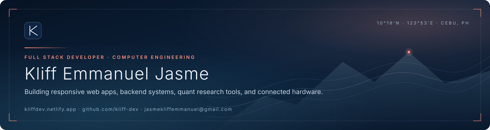

  

  
  
  

 

### About Me

I'm a **Full Stack Developer** and **BS Computer Engineering** graduate based in **Cebu, Philippines**. I build practical end-to-end software across web applications, backend services, relational databases, desktop tools, and connected hardware—focused on clean architecture, automated testing, and reliable real-world execution.

---

### Featured Projects

| Project | Focus | Stack | Links |
| :--- | :--- | :--- | :--- |
| **[Project Quant](https://github.com/kliff-dev/project-quant)** | Local Python quantitative backtesting lab, Windows WebView2 desktop app, and risk-bounded MT5 DEMO execution monitor with strict identity/freshness guards & `pytest` suite | `Python` `Streamlit` `WebView2` `MT5` `pytest` | [Repository](https://github.com/kliff-dev/project-quant) |
| **[Bellton Heavy Equipment Rental](https://bellton.netlify.app/)** | Production web application for a Cebu heavy-equipment rental business featuring equipment browsing, quote calculation, customer accounts, Supabase Auth/RLS & admin revision history | `HTML` `CSS` `JavaScript` `Supabase` `Netlify` | [Live Site](https://bellton.netlify.app/) |
| **[LuxLock Biometric Security System](https://github.com/kliff-dev/luxlock_app)** | Computer Engineering capstone connecting a Flutter mobile Control Center & fingerprint enrollment app with Firebase RTDB/Cloud Functions and ESP32 actuators across 3 secured cases | `Flutter` `Dart` `Firebase` `ESP32` `C++` | [Repository](https://github.com/kliff-dev/luxlock_app) |
| **[Developer Portfolio (`myprofile`)](https://github.com/kliff-dev/myprofile)** | Zero-dependency HTML/CSS/JS portfolio featuring a real-time procedural WebGL2 Cebu island & ocean engine, accessible native dialogs, and 48 automated Node tests | `HTML` `CSS` `JavaScript` `WebGL2` `GLSL` | [Live Site](https://kliffdev.netlify.app/) · [Code](https://github.com/kliff-dev/myprofile) |
| **[DevTrack](https://github.com/kliff-dev/devtrack)** | Personal developer activity & project dashboard with a local Node collector that parses Git commits and AI coding sessions into a responsive React/TypeScript workspace | `React` `TypeScript` `Vite` `Node.js` | [Repository](https://github.com/kliff-dev/devtrack) |
| **[Move Up Academy — Word Lab](https://kliffdev.netlify.app/projects.html#word-lab)** | Bilingual listening & typing vocabulary trainer (26 book lists, 3,030 entries), PHP/MySQL student progress integration, and WeChat in-app browser audio playback fixes | `PHP` `MySQL` `JavaScript` `HTML` `CSS` | [Case Study](https://kliffdev.netlify.app/projects.html#word-lab) |

---

### Technical Stack

| Domain | Technologies |
| :--- | :--- |
| **Languages** | `JavaScript` · `TypeScript` · `Python` · `PHP` · `SQL` · `Dart` · `C#` · `C++` |
| **Frontend & Apps** | `HTML5` · `CSS3` · `React` · `Vite` · `Flutter` · `WPF / XAML` · `WebGL2 / GLSL` |
| **Backend & Data** | `Node.js` · `REST APIs` · `Supabase (Auth, PostgreSQL, RLS)` · `Firebase (RTDB, Functions, FCM)` · `MySQL` · `SQLite` · `SQL Server LocalDB` |
| **Hardware & Systems** | `ESP32` · `Arduino` · `Embedded IoT` · `Linux` · `Networking (VLANs, Routing, OSPF, ACLs)` |
| **Engineering Workflow** | `Git & GitHub` · `Node Test Runner` · `pytest` · `Flutter Test` · `Netlify` |

---

  Open to Full Stack & Software Engineering opportunities · <a href="https://kliffdev.netlify.app/projects.html">Explore all 16 projects →</a>

